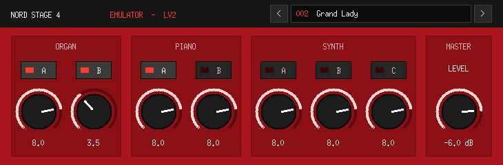

# nord-lv2 — LV2 instrument (Linux, Raspberry Pi 5)

An LV2 build of the Nord Stage 4 Emulator engine (`nord-core`) for Linux hosts such as Carla,
Ardour, jalv, mod-host and Zynthian, including aarch64 / Raspberry Pi 5 on Debian trixie.

It is a thin wrapper. The LV2 C ABI is declared by hand, so it needs no nih-plug, egui, X11 or LV2
headers, and the only dependency is `nord-core`.

## Build and install

```bash
crates/nord-lv2/install-lv2.sh
```

This builds `target/release/libnord_lv2.so` (plugin) and `libnord_lv2_ui.so` (GUI) and copies them, with the TTL files from
`bundle/nord-stage4.lv2/`, to `~/.lv2/nord-stage4.lv2/`. Set `LV2_DEST` to install somewhere
else, for example `LV2_DEST=/usr/local/lib/lv2` (that path needs sudo).

Quick test with jalv (`sudo apt install jalv lilv-utils`). `jalv.gtk3` shows the plugin's own GUI; plain `jalv` is the console version:

```bash
lv2info 'https://github.com/ymatrix1/nord-stage-4-emulator#lv2'
jalv.gtk3 'https://github.com/ymatrix1/nord-stage-4-emulator#lv2'
```

## Ports

| Index | Symbol | What |
|---|---|---|
| 0 | `midi_in` | MIDI in. Channel 1 plays the layers that are switched on; CCs follow the Nord Stage 4 CC map (`nord_core::midi::cc`) |
| 1–2 | `out_l`, `out_r` | Main outputs 1-2 |
| 3–4 | `aux_l`, `aux_r` | Outputs 3-4 (optional; silent unless the engine routes something there) |
| 5 | `master` | Master level, −60 to +6 dB (−60 = silent) |
| 6–12 | `*_on` | Layer on/off (Scene I): Organ A, Organ B, Piano A, Piano B, Synth A, B, C |
| 13–19 | `*_level` | Layer levels 0–1, same order |
| 20 | `program` | Program select: 0 = engine defaults, N = N-th program file (see below) |
| 21 | `program_out` | Output: program now playing (also follows MIDI Program Change) |
| 22–28 | `*_on_out` | Output: layer really on/off (a loaded program changes this) |
| 29–35 | `*_level_out` | Output: layer level now |

The defaults match a fresh engine: Organ A, Piano A and Synth A on, all levels at 0.8. A control
port is written to the engine only when its value changes, so MIDI CCs that move the same state
(layer levels, Scene II) keep working between knob moves.

## Programs (`.ns4p`)

Put Nord Stage 4 program files (`.ns4p`, for example saved with Nord Sound Manager) in
`~/.config/ns4/programs/`. Sub-folders such as `Bank A/` are fine. Set `NS4_PROGRAM_DIR` to use
another folder. Programs are numbered 1, 2, 3, ... in alphabetical order of their path; the
folder is read when the plugin (and the GUI) is opened.

- Choose a program with the `program` control or the GUI's `<` / `>` buttons.
- MIDI Program Change P on the global channel (with bank MSB 0) loads program P + 1, and bank
  LSB L adds 128 × L.
- Loading runs on the host's worker thread (LV2 Worker), never on the audio thread. The new
  program replaces the whole engine, so held notes stop.
- After a load the layer buttons and levels follow the program (output ports 22–35). Turning a
  control afterwards changes only that control.

## Nord OS file (WAVE wavetables)

The synth's WAVE wavetables are in the official Nord Stage 4 OS update, which is not in this
repository (see [docs/guides/nord-os-update.md](../../docs/guides/nord-os-update.md)). The plugin
uses the same file as `ns4` and `nord-stage4`: `$NS4_WAVE_TABLES`, else the file saved with
`ns4 firmware set`. It is read once when the plugin loads; without it a placeholder wavetable plays.

## GUI (X11)

`crates/nord-lv2-ui` builds `libnord_lv2_ui.so`, an X11 panel declared in `manifest.ttl` as
`ui:X11UI`. It embeds into the host window (Carla, Ardour, Zynthian) or opens its own window
(`jalv.gtk3`). It needs `libx11-dev` to build.



- Click a layer button to switch the layer on or off; its LED lights up when it is on.
- Drag a knob up or down, or use the mouse wheel. Hold Shift (or Ctrl) for fine steps.
- Right-click resets a control to its default.
- Header: `<` / `>` or the mouse wheel over the name steps through programs; right-click the
  name for program 0 (engine defaults).

## Real-time behaviour

`run()` never allocates, locks or does I/O. MIDI events are applied at their exact frame offset,
and blocks of any size are rendered in 256-frame chunks through `process_block_multi`.
`activate()` rebuilds the engine.

## Not yet included

- No LV2 state save yet: a host session does not remember edits made after loading a program.
- Programs only from single `.ns4p` files, not from inside a `.ns4b` backup.
- No host tempo (`time:Position`) yet; the master clock runs at its default BPM.
